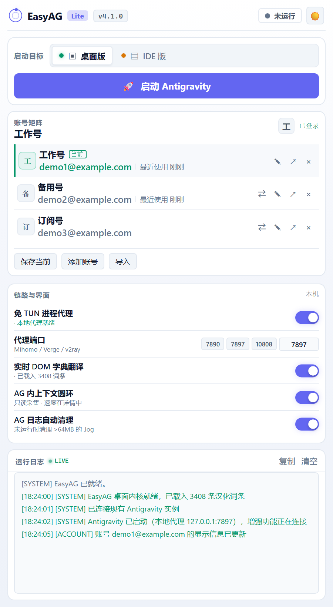
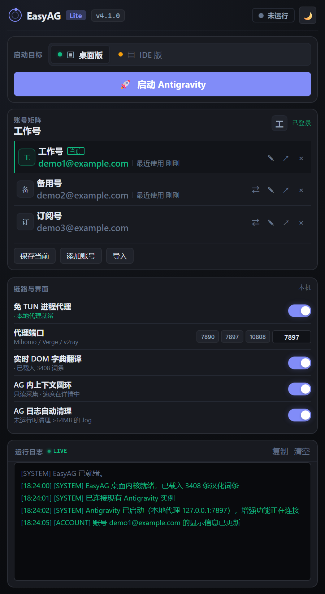

<p align="center">
  
</p>

<h1 align="center">EasyAG</h1>

<p align="center"><strong>Antigravity 多账号一键切换 · 可逆汉化 · 上下文圆环</strong><br>Windows 10/11 x64 · 便携版</p>

<p align="center">
  
  
  <a href="https://github.com/zengzengbin/EasyAG/releases/latest"></a>
</p>

> EasyAG 是基于 MIT 开源项目 [EasyAntigravity](https://github.com/DSDS-CMHL/EasyAntigravity) 的 Windows 定制版，与 Google 官方无关。**仅支持 Windows 10/11 x64。**



<details>
<summary>深色主题</summary>

</details>

## 这是什么

EasyAG 是 Antigravity 的便携启动器：把多个 Google 账号保存为本地加密档案，需要时一键切换；启动 Antigravity 时注入本地代理、汉化和上下文圆环。所有账号操作都在本机完成，不做额度池化、不做 token 中继、不自动换号。

适合这些场景：

- 有多个 Google 账号，需要在 Antigravity 里手动切换；
- 希望 Antigravity 界面显示中文，并且随时可逆；
- 使用本地代理（Mihomo / Clash Verge / v2rayN 等），但不想开 TUN；
- 想在 Antigravity 输入区看到最近请求的上下文估算。

## 功能

### 多账号一键切换

- 把当前登录的 Antigravity 账号保存为档案，凭证使用 **Windows DPAPI（CurrentUser）** 加密，token 不落明文。
- 切换账号时先停净 Antigravity，再写回目标凭证；如果切换前 Antigravity 正在运行，会自动重新启动。
- 支持账号别名、备注、最近使用时间；列表直接显示“邮箱 + 最近使用”。
- 支持导入/导出 JSON 档案。**导出文件包含登录凭证，请勿分享。**

### 启动与网络

- 免 TUN 进程代理：启动时向 Antigravity 传入本地 HTTP 代理配置，支持 `7890` / `7897` / `10808` 常用端口和自定义端口。
- 直连环境可关闭代理；EasyAG 不提供任何代理节点。
- 桌面版 / IDE 版启动目标切换，自动寻找安装位置；找不到时弹出路径配置。
- 进程冲突恢复：已有 Antigravity 进程阻止启动时，可“清理并重新启动”。

### 汉化与上下文

- 桌面版通过 CDP 动态翻译界面，关闭开关后恢复原文，不修改 Antigravity 安装文件。
- 上下文圆环只读采集最近请求的上下文估算，详情里显示采样模型与输出速度；估算值不代表服务端精确计费。
- 汉化仅用于桌面版；IDE 版保留启动、代理与上下文圆环。

### 维护

- **AG 日志自动清理**：仅在 Antigravity 未运行时，删除 `%APPDATA%\Antigravity\logs` 下超过 64MB 的直接子级 `.log` 文件；不递归、不跟随链接。
- 关闭窗口后驻留系统托盘；彻底退出请使用托盘菜单“退出应用”。
- 用户数据保存在 `%LOCALAPPDATA%\com.easyag.launcher.tauri\`，升级程序不需要删除配置。

## 明确不做

- ❌ 额度看板 / 额度窗口（已移除；不请求额度接口，不生成额度缓存）
- ❌ 额度耗尽自动 failover / 无感换号
- ❌ 用账号 token 直连 Google 额度接口 / 多账号 API 中继
- ❌ macOS / Linux 版本
- ❌ 自动更新 / 上游热更新通道
- ❌ 账号共享、出租或商业转售

## 下载与安装

1. 打开 [Releases](https://github.com/zengzengbin/EasyAG/releases/latest)，下载 `EasyAG-v4.1.0-windows-x64.zip`。
2. 解压到一个可写目录（例如 `D:\EasyAG`），**不要直接在压缩包里运行**。
3. 确认以下文件在同一目录：

   ```text
   EasyAG/
   ├─ EasyAntigravity.exe
   ├─ WebView2Loader.dll
   ├─ easyag-node.exe
   ├─ backend/
   ├─ README.md
   ├─ NODE-LICENSE.txt
   ├─ LICENSE
   └─ THIRD-PARTY-NOTICES.md
   ```

4. 双击 `EasyAntigravity.exe`。

系统要求：

- Windows 10 / 11 x64。
- Microsoft Edge WebView2 Runtime（大多数 Windows 10/11 已自带；没有时从 [微软官网](https://developer.microsoft.com/microsoft-edge/webview2/) 安装）。
- 不需要安装 Node.js、Rust 或 Python。

> `WebView2Loader.dll` 必须和 `EasyAntigravity.exe` 放在同一目录，删除后程序无法启动。

### 关于 SmartScreen

发布包没有代码签名。Windows SmartScreen 可能提示“未知发布者”，可点击“更多信息 → 仍要运行”。请只从本仓库 Releases 下载，并用发布说明里的 SHA-256 校验文件完整性。

## 首次使用

1. 打开 EasyAG，确认启动目标为“桌面版”。
2. 选择代理端口，或关闭“免 TUN 进程代理”使用直连。
3. 点击“启动 Antigravity”，在 Antigravity 里登录你的 Google 账号。
4. 回到 EasyAG，点击“保存当前”，这个账号就保存为加密档案。
5. 添加第二个账号：点击“添加账号”，按引导退出当前登录并登录另一个账号，再保存。
6. 之后在账号列表点击 `⇄` 即可切换；Antigravity 会重启并应用新凭证。
7. 点击 `✎` 修改别名/备注，`↗` 导出档案，`×` 删除档案。

> 切换账号会关闭 Antigravity，请先保存工作。Antigravity 必须由 EasyAG 启动，汉化和上下文圆环才能注入；如果 Antigravity 已经在运行，请使用“清理并重新启动”。

## 常见问题

**为什么没有额度窗口？**  
额度看板曾实现过，但作者确认不需要，已整体移除：不显示额度、不请求本地额度 RPC、不生成额度缓存。需要看额度请直接使用 Antigravity 自己的界面。

**切换账号会被封号吗？**  
EasyAG 只做本机凭证切换，不做额度池化、并发多开、token 中继或自动轮换。但多账号轮换仍可能违反 Google 的服务条款，存在账号风险；请只使用自己的账号，并自行承担风险。

**EasyAG 会上传我的账号吗？**  
不会。凭证只写入 Windows 凭据管理器和本地 DPAPI 档案；EasyAG 不调用 Google 账号接口、不读取 token 内容到日志、不提供遥测。代理设置只影响 Antigravity 进程的启动参数。

**可以同时运行多个账号吗？**  
不可以。Antigravity 同一时间只使用一个凭证；EasyAG 的切换是“停掉 → 换凭证 → 重启”，不是多开。

**为什么托盘里还有 EasyAG？**  
关闭窗口只是隐藏到托盘，不会退出。要彻底退出，请右键托盘图标选择“退出应用”。

**怎么备份账号？**  
使用账号行的 `↗` 导出 JSON。导出文件包含可登录凭证，必须存放在安全位置，不要发给别人。

**支持 macOS / Linux 吗？**  
不支持。当前发布包只提供 Windows x64。

## 安全说明

- 账号档案位于 `%LOCALAPPDATA%\com.easyag.launcher.tauri\accounts\`，敏感载荷由 Windows DPAPI 以当前用户身份加密。
- 明文头只保存邮箱、别名、备注、时间戳和 `refreshHash`，不保存 token。
- 日志与 API 不输出 token；额度相关接口与缓存已移除。
- 导入/导出 JSON 是明文凭证格式，请自行保管。
- 本项目使用 MIT 协议，按“现状”提供，不提供任何担保。

## 开发

需要 Node.js 22+、Rust 和 Windows 构建依赖。

```sh
npm ci
npm test
node test/launcher-browser.cjs "C:\Program Files (x86)\Microsoft\Edge\Application\msedge.exe"
```

启动后端开发模式：

```sh
npm start
```

自编译 Windows 原生壳（当前发布包使用 MinGW-w64 gnu 构建）：

```sh
node scripts/prepare-tauri.cjs x86_64-pc-windows-gnu
cd src-tauri
cargo build --release --target x86_64-pc-windows-gnu
```

产物在 `src-tauri/target/x86_64-pc-windows-gnu/release/easyantigravity.exe`。打包时还需要：

- 把 `src-tauri/binaries/easyag-node-x86_64-pc-windows-gnu.exe` 复制为交付目录的 `easyag-node.exe`；
- 把 `src-tauri/backend/` 整体复制为交付目录的 `backend/`；
- 从 `webview2-com-sys` 的 `x64/` 目录复制 `WebView2Loader.dll` 到 exe 同级。

也可以使用 MSVC 工具链（`x86_64-pc-windows-msvc`），此时原生壳不依赖外置 `WebView2Loader.dll`，但构建机需要 Visual Studio Build Tools。

### 项目结构

```text
EasyAntigravity/
├─ index.html / ui/          启动器面板
├─ desktop/                  应用组装、HTTP API
├─ core/                     会话、设置、存储
├─ features/                 账号、汉化、上下文、日志清理
├─ adapters/desktop/         Windows 凭据、CDP、语言服务
├─ dicts/                    汉化词典
├─ src-tauri/                Tauri 原生壳
└─ test/                     单元测试与浏览器回归
```

## 致谢

- 上游项目：[DSDS-CMHL/EasyAntigravity](https://github.com/DSDS-CMHL/EasyAntigravity)（MIT）
- 汉化词典来源于社区整理，包括 [nicktan @ linux.do](https://linux.do/t/topic/2896116)
- 上下文监控相关实现参考 [Antigrative Dashboard / AG Pulse](https://github.com/YOU-SHOULD-KNOW-ME/antigrative-dashboard)（MIT）

EasyAG 与 Google 官方无关。使用 [MIT License](LICENSE)，第三方声明见 [THIRD-PARTY-NOTICES.md](THIRD-PARTY-NOTICES.md)。

<details>
<summary>English overview</summary>

EasyAG is a Windows-only, MIT-licensed launcher for Antigravity. It adds DPAPI-encrypted multi-account profiles, one-click account switching, reversible Chinese UI localization, a read-only context ring, TUN-free proxy launch options, and safe Antigravity log cleanup. It does not pool quotas, relay tokens, or switch accounts automatically. Requires Windows 10/11 x64 and the WebView2 Runtime.

</details>
